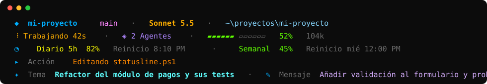

# Barra de estado para Claude Code



_Datos de ejemplo. Los límites se ponen amarillos desde el 80 % y rojos por encima del 90 %._

Barra de estado de 5 líneas para Claude Code en Windows (PowerShell 5.1). Pensada para tener varios chats abiertos y saber de un vistazo en qué está cada uno, cuánto contexto y cuánto límite de uso queda.

## Funciones

### Línea 1: identidad
- **Carpeta de trabajo** con un color propio por sesión (se deriva del id de sesión, así cada chat tiene su color).
- **Rama de git**, leída directamente de `.git/HEAD` sin lanzar procesos.
- **Modelo** que estás usando.
- **Ruta** del directorio de trabajo. Usa `~` para tu carpeta de usuario y, si pasa de 38 caracteres, se abrevia a `C:\…\padre\carpeta`.

### Línea 2: estado y contexto
- **Estado**: `Trabajando` con spinner animado y los segundos desde tu último mensaje, o `Libre` con un punto fijo. Si el historial lleva más de 3 minutos sin actividad, pasa a `Libre`.
- **Esperando agentes**: si hay agentes en marcha y Claude lleva más de 10 s sin escribir en la conversación, el estado cambia a `Esperando N agentes` (en violeta) en vez de `Trabajando`. En cuanto Claude vuelve a actuar, regresa a `Trabajando`.
- **Agentes**: número de agentes en marcha, contando los lanzados en primer plano y los de segundo plano (se leen de `<sesión>/subagents/agent-*.jsonl`; cuenta como activo el que se haya escrito en los últimos 45 s y no haya terminado). Mientras haya agentes activos, el estado nunca es `Libre`: es `Trabajando` o `Esperando agentes`.
- **Barra de contexto** de 12 segmentos, con porcentaje y tokens usados en miles. Color: verde por debajo del 50 %, amarillo por debajo del 75 %, naranja por debajo del 90 % y rojo a partir de ahí.
- **Aviso de `/compact`** a la derecha de la barra: no se muestra por debajo del 60 %; `/compact pronto` (amarillo) desde el 60 %, `/compact recomendado` (naranja) desde el 80 % y `/compact YA` (rojo parpadeante) desde el 85 %.

- **Skill de ahorro de tokens**: si en la sesión se ha usado la skill `ahorro-tokens` (invocada como herramienta `Skill` o con el comando `/ahorro-tokens`), aparece `◉ Ahorro tokens` en verde azulado justo a la derecha del aviso de `/compact`. Se recuerda durante el resto de la sesión (archivo `~/.claude/state/skill-<id de sesión>.txt`). Para vigilar otra skill, cambia `ahorro-tokens` por su nombre en la expresión regular de `statusline.ps1` (busca `ahorro-tokens`) y el texto `Ahorro tokens`.

### Línea 3: límites de uso
- **Diario (5 h)** y **semanal**, siempre visibles, con el porcentaje usado.
- Colores: verde por debajo del 80 %, amarillo desde el 80 % y rojo por encima del 90 %.
- **Parpadeo** del límite diario por encima del 92 % y del semanal por encima del 95 %.
- **Hora real de reinicio** en formato de 12 horas (`Reinicio 8:10 PM`; si cae otro día, con el día: `Reinicio mié 12:00 PM`).
- Si tu plan no tiene límites de uso (por ejemplo, uso por API), aparecen como `--`.

### Línea 4: acción en curso
- Muestra qué está haciendo Claude en este momento, con un verbo y su objetivo: `Editando archivo.ps1`, `Escribiendo …`, `Leyendo …`, `Ejecutando <comando>`, `Buscando …`, `Agente …`, etc.
- Si no hay nada en marcha, pone `En espera`.
- Si pasan más de 45 s sin actividad, añade `sin actividad` en amarillo con el tiempo transcurrido, para detectar si algo se ha quedado atascado.
- La línea siempre está presente, así que la barra no cambia de altura.

### Línea 5: tema y resumen del último mensaje
- **Tema**: de qué va la conversación en general, para distinguir un chat de otro.
- **Mensaje**: resumen del último mensaje que enviaste.
- Ambos van en la misma línea y comparten un ancho de 118 caracteres. Al hook se le pide un tema de máximo 40 caracteres y un mensaje de máximo 65, para que quepan enteros y se gasten menos tokens de salida. Si aun así no caben, se recortan los dos en proporción, con `…`.
- Ignora los mensajes automáticos del sistema (notificaciones de tareas, etc.).
- Guarda los últimos mensajes en una caché, de modo que siguen apareciendo aunque el historial se llene de salidas largas de agentes.
- Origen del tema, por prioridad: archivo manual, resumen de Haiku (si instalas el hook) y, como respaldo gratuito, palabras clave de los últimos mensajes.
- Origen del mensaje: resumen de Haiku (si instalas el hook) o, como respaldo, el último mensaje.

### General
- **Sin distracciones al leer**: los parpadeos (límites, `/compact YA`) y el spinner solo se animan mientras Claude trabaja o espera a agentes. Cuando está `Libre`, todo queda fijo, con el mismo color y sin moverse, para no distraerte mientras lees su respuesta.
- Se refresca cada segundo (`refreshInterval: 1`), lo que permite las animaciones y los parpadeos.
- Columnas de ancho fijo: la barra no se mueve cuando cambian los números.
- No lanza procesos externos: solo lee el historial de la sesión y archivos locales.
- No envía datos a ningún sitio. Lo único que hace una llamada a Claude es el hook opcional de resumen.

## Instalación
1. Copia `statusline.ps1` a `C:\Users\<tu-usuario>\.claude\`.
2. Añade a `C:\Users\<tu-usuario>\.claude\settings.json`:

```json
"statusLine": {
  "type": "command",
  "command": "powershell -NoProfile -ExecutionPolicy Bypass -File C:/Users/<tu-usuario>/.claude/statusline.ps1",
  "refreshInterval": 1
}
```
3. Reinicia Claude Code.

## Tema y resumen con sentido (opcional, usa Haiku)
Un hook genera con Claude Haiku el tema de la conversación y el resumen del último mensaje, y la barra los muestra en la última línea. Se actualiza con el 1.er mensaje y después cada 3. Gasta unos ~1.300 tokens de entrada por llamada (medido). Si no lo instalas, la barra usa palabras clave (gratis, pero con menos sentido).

1. Copia `hooks/summarize_prompt.py` a `C:\Users\<tu-usuario>\.claude\hooks\`.
2. Añade a `settings.json`:

```json
"hooks": {
  "UserPromptSubmit": [
    { "hooks": [ { "type": "command", "command": "python C:/Users/<tu-usuario>/.claude/hooks/summarize_prompt.py" } ] }
  ]
}
```
3. Reinicia Claude Code. Necesita `python` y `claude` en el PATH.

## Requisitos y notas
- Windows con PowerShell 5.1; Python solo para el hook opcional.
- Pensado para mensajes en español.
- Tema manual: escribe una línea en `~/.claude/state/topic-<id de sesión>.txt` (tiene prioridad sobre el resto).
